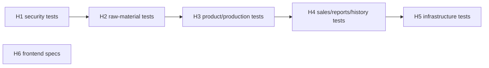

# MVP Capability Change Plan

**Step 5 of the onboarding** — the plan for NEW work only. The original 149 MVP functional requirements already shipped; each was owned by exactly one *retrofit baseline slice* (the 16 capability specs in `openspec/specs/`, listed in `.project-factory/retrofit.json`). FR-150 is the later `modal-keyboard-focus` slice. This plan records approved changes to shipped behavior.

> Inputs: `docs/product-brief.md`, `docs/requirements.md` (ratified by volodya4u on 2026-10-11, defaults included), baseline specs under `openspec/specs/`, ADR-0001.

## 1. Slicing principles

1. The new work is derived from the 71 rows of `docs/requirements.md` › Coverage gaps (GAP and PARTIAL): behavior the baseline records but no test asserts. No feature is invented.
2. Every slice is **test-only**: new or extended tests that pin today's behavior. Production code under `src/main` and `frontend/src` (non-spec files) is not changed. If a test exposes behavior that looks wrong (OQ-1, the stored selling price, looked like this until the owner stated on 2026-10-11 that it is intended), the slice stops and reports it; fixing it is a separate behavior slice the user approves.
3. One slice per cohesive area, sized to design, build, test and archive as a unit. Naming: kebab-case `harden-<area>` under `openspec/changes/`.
4. Each gap row is hardened by exactly one slice (or explicitly deferred, section 6). Each baseline FR keeps one retrofit owner.
5. Backend slices extend the shared `InventoryFlowIntegrationTest`, so they are `serialize`. The frontend slice touches only `*.spec.ts` files and is `parallel-safe`.
6. This repo's rules still apply to every slice: the `AGENTS.md` Definition of done (`node scripts/dod.mjs`), the `reviewer` subagent, a `docs/autonomy-log.md` row, and `docs/specs/TEMPLATE.md` when a slice needs a spec.

## 2. The capability changes

| # | Change name | Baseline specs touched | Gap rows | Depends on | Parallel |
|---|---|---|---|---|---|
| H1 | `harden-security-tests` | authentication, session-lifetime, app-shell-routing | 17 | — | serialize (shared test file; auth/ and SecurityConfig tests need plan mode and `/security-review`) |
| H2 | `harden-raw-material-tests` | raw-materials, raw-material-stock, reorder-level | 10 | H1 | serialize (shared test file) |
| H3 | `harden-product-and-production-tests` | products, product-stock, production | 10 | H2 | serialize (shared test file) |
| H4 | `harden-sales-reports-history-tests` | sales, returns-cancellations, dashboard, monthly-sales-report, stock-history | 17 | H3 | serialize (shared test file) |
| H5 | `harden-infrastructure-tests` | images, schema-migration, app-shell-routing | 7 | H4 | serialize (shared test file; schema tests) |
| H6 | `harden-frontend-specs` | app-shell-routing, images, products, raw-materials, monthly-sales-report | 8 | — | parallel-safe (only `frontend/src/**/*.spec.ts`) |

**Cross-cutting rules every slice honors:** NFR-12 (each business operation is one transaction) and NFR-14 (exact decimal money and quantity arithmetic): no operation, money or quantity logic is touched. TC-2 (no schema change without the schema.sql plus migration pair, and none is planned), BC-1 (nothing new without a human decision) and BC-3 (ask before a dependency or before editing guarded files; no change to `pom.xml` or `frontend/package.json`).

## 3. Dependency graph

**Critical path:** H1 → H2 → H3 → H4 → H5 (serialized on `InventoryFlowIntegrationTest`). **Parallelizable:** H6 runs in its own worktree at any time; it shares no file with H1–H5.

## 4. Per-change scope and exit criteria

Common to all slices — **Definition of done:** the listed gap rows are asserted by tests that carry `@trace <id>` tags; `node scripts/dod.mjs` is green; `git diff` shows no change to production code; the matching rows leave `## Coverage gaps` in `docs/requirements.md` in the same pull request; the `reviewer` verdict is recorded; an autonomy-log row is added.

### 4.1 H1 `harden-security-tests`
- **Scope in:** FR-2, FR-3, FR-4, FR-6, FR-8, FR-12, FR-13, NFR-1, NFR-2, NFR-3, NFR-4, NFR-5, NFR-6, NFR-7, NFR-9, NFR-10, NFR-11.
- **Scope out:** any change to `SecurityConfig`, `auth/` production code or the password policy; adding throttling or lockout (OQ-6, OQ-7, OQ-13 stay ratified as-is). NFR-10 and NFR-11 are absences, pinned by guard tests, not built.
- **Risks:** touches `auth/` and `SecurityConfig` tests, so start in plan mode and run `/security-review` (`CLAUDE.md`).

### 4.2 H2 `harden-raw-material-tests`
- **Scope in:** FR-42, FR-43, FR-46, FR-48, FR-49, FR-54, FR-56, FR-60, FR-61, FR-67.
- **Scope out:** making raw-material names unique (FR-56 pins that duplicates are accepted today, OQ-3).
- **Risks:** FR-54 pins that history is deleted with the material (OQ-5, ratified).

### 4.3 H3 `harden-product-and-production-tests`
- **Scope in:** FR-76, FR-79, FR-80, FR-83, FR-85, FR-88, FR-93, FR-97, FR-98, FR-99.
- **Scope out:** recalculating a stored selling price after a cost change (OQ-1, ratified as-is).

### 4.4 H4 `harden-sales-reports-history-tests`
- **Scope in:** FR-37, FR-38, FR-102, FR-103, FR-107, FR-109, FR-110, FR-114, FR-116, FR-117, FR-118, FR-127, FR-131, FR-132, FR-134, FR-141, FR-143.
- **Scope out:** date limits (OQ-4); changing the return average-cost blend (OQ-16).

### 4.5 H5 `harden-infrastructure-tests`
- **Scope in:** FR-33, FR-70, FR-72, FR-73, FR-74, FR-149, NFR-13.
- **Scope out:** removing an image (OQ-11); any schema change (`schema.sql` and `InventorySchemaMigration` stay untouched).
- **Risks:** NFR-13 (concurrent deduction) needs a concurrency test on SQLite; if it cannot be made deterministic, report it instead of landing a flaky test.

### 4.6 H6 `harden-frontend-specs`
- **Scope in:** FR-34, FR-55, FR-75, FR-86, FR-146, NFR-19, NFR-21, NFR-22.
- **Scope out:** any change to components; currency stays display-only (OQ-14).

## 5. FR coverage check

Every MVP FR has one baseline owner; the last column shows the hardening slice that closes its coverage gap, if it has one.

| FR | Baseline owner (retrofit slice) | Hardened by |
|---|---|---|
| FR-1 | authentication | - |
| FR-2 | authentication | H1 |
| FR-3 | authentication | H1 |
| FR-4 | authentication | H1 |
| FR-5 | authentication | - |
| FR-6 | authentication | H1 |
| FR-7 | authentication | - |
| FR-8 | authentication | H1 |
| FR-9 | authentication | - |
| FR-10 | authentication | - |
| FR-11 | authentication | - |
| FR-12 | authentication | H1 |
| FR-13 | authentication | H1 |
| FR-14 | authentication | - |
| FR-15 | authentication | - |
| FR-16 | authentication | - |
| FR-17 | authentication | - |
| FR-18 | authentication | - |
| FR-19 | authentication | - |
| FR-20 | authentication | - |
| FR-21 | authentication | - |
| FR-22 | authentication | - |
| FR-23 | session-lifetime | - |
| FR-24 | session-lifetime | - |
| FR-25 | session-lifetime | - |
| FR-26 | session-lifetime | - |
| FR-27 | session-lifetime | - |
| FR-28 | session-lifetime | - |
| FR-29 | session-lifetime | - |
| FR-30 | session-lifetime | - |
| FR-31 | session-lifetime | - |
| FR-32 | session-lifetime | - |
| FR-33 | app-shell-routing | H5 |
| FR-34 | app-shell-routing | H6 |
| FR-35 | app-shell-routing | - |
| FR-36 | app-shell-routing | - |
| FR-37 | dashboard | H4 |
| FR-38 | dashboard | H4 |
| FR-39 | dashboard | - |
| FR-40 | dashboard | - |
| FR-41 | dashboard | - |
| FR-42 | raw-materials | H2 |
| FR-43 | raw-materials | H2 |
| FR-44 | raw-materials | - |
| FR-45 | raw-materials | - |
| FR-46 | raw-materials | H2 |
| FR-47 | raw-materials | - |
| FR-48 | raw-materials | H2 |
| FR-49 | raw-materials | H2 |
| FR-50 | raw-materials | - |
| FR-51 | raw-materials | - |
| FR-52 | raw-materials | - |
| FR-53 | raw-materials | - |
| FR-54 | raw-materials | H2 |
| FR-55 | raw-materials | H6 |
| FR-56 | raw-materials | H2 |
| FR-57 | reorder-level | - |
| FR-58 | reorder-level | - |
| FR-59 | reorder-level | - |
| FR-60 | reorder-level | H2 |
| FR-61 | raw-material-stock | H2 |
| FR-62 | raw-material-stock | - |
| FR-63 | raw-material-stock | - |
| FR-64 | raw-material-stock | - |
| FR-65 | raw-material-stock | - |
| FR-66 | raw-material-stock | - |
| FR-67 | raw-material-stock | H2 |
| FR-68 | raw-material-stock | - |
| FR-69 | raw-material-stock | - |
| FR-70 | images | H5 |
| FR-71 | images | - |
| FR-72 | images | H5 |
| FR-73 | images | H5 |
| FR-74 | images | H5 |
| FR-75 | images | H6 |
| FR-76 | products | H3 |
| FR-77 | products | - |
| FR-78 | products | - |
| FR-79 | products | H3 |
| FR-80 | products | H3 |
| FR-81 | products | - |
| FR-82 | products | - |
| FR-83 | products | H3 |
| FR-84 | products | - |
| FR-85 | products | H3 |
| FR-86 | products | H6 |
| FR-87 | products | - |
| FR-88 | production | H3 |
| FR-89 | production | - |
| FR-90 | production | - |
| FR-91 | production | - |
| FR-92 | production | - |
| FR-93 | production | H3 |
| FR-94 | production | - |
| FR-95 | product-stock | - |
| FR-96 | product-stock | - |
| FR-97 | product-stock | H3 |
| FR-98 | product-stock | H3 |
| FR-99 | product-stock | H3 |
| FR-100 | product-stock | - |
| FR-101 | sales | - |
| FR-102 | sales | H4 |
| FR-103 | sales | H4 |
| FR-104 | sales | - |
| FR-105 | sales | - |
| FR-106 | sales | - |
| FR-107 | sales | H4 |
| FR-108 | sales | - |
| FR-109 | sales | H4 |
| FR-110 | sales | H4 |
| FR-111 | sales | - |
| FR-112 | sales | - |
| FR-113 | sales | - |
| FR-114 | returns-cancellations | H4 |
| FR-115 | returns-cancellations | - |
| FR-116 | returns-cancellations | H4 |
| FR-117 | returns-cancellations | H4 |
| FR-118 | returns-cancellations | H4 |
| FR-119 | returns-cancellations | - |
| FR-120 | returns-cancellations | - |
| FR-121 | returns-cancellations | - |
| FR-122 | returns-cancellations | - |
| FR-123 | returns-cancellations | - |
| FR-124 | returns-cancellations | - |
| FR-125 | returns-cancellations | - |
| FR-126 | returns-cancellations | - |
| FR-127 | stock-history | H4 |
| FR-128 | stock-history | - |
| FR-129 | stock-history | - |
| FR-130 | stock-history | - |
| FR-131 | stock-history | H4 |
| FR-132 | stock-history | H4 |
| FR-133 | stock-history | - |
| FR-134 | stock-history | H4 |
| FR-135 | stock-history | - |
| FR-136 | monthly-sales-report | - |
| FR-137 | monthly-sales-report | - |
| FR-138 | monthly-sales-report | - |
| FR-139 | monthly-sales-report | - |
| FR-140 | monthly-sales-report | - |
| FR-141 | monthly-sales-report | H4 |
| FR-142 | monthly-sales-report | - |
| FR-143 | monthly-sales-report | H4 |
| FR-144 | monthly-sales-report | - |
| FR-145 | monthly-sales-report | - |
| FR-146 | monthly-sales-report | H6 |
| FR-147 | schema-migration | - |
| FR-148 | schema-migration | - |
| FR-149 | schema-migration | H5 |
| FR-150 | app-shell-routing | modal-keyboard-focus |

Total: **150 MVP FRs across 16 capability specs** (149 retrofit requirements plus FR-150; no gaps or duplicates); **69 of 71 coverage-gap rows** are assigned to 6 new slices (NFR gap rows are listed in section 4).

## 6. Deferred and blocked (not in this plan)

| Item | Why it is not a slice |
|---|---|
| NFR-15 (performance), NFR-16 (availability, backup) | Budgets and targets are undeclared (OQ-9, OQ-10). A slice needs a ratified budget to assert, so ask the owner first. |
| NFR-17 (`e2e`), NFR-18 (`vision-verify`), NFR-20 (`a11y`) | Waived at baseline. Playwright and axe were approved and installed on 2026-10-30, OQ-8 and OQ-15 were answered, and the three waivers are closed (ADR-0010, ADR-0011). |
| Behavior changes suggested by the open questions (OQ-5, 6, 7, 11, 13) | The owner ratified current behavior. Each would be its own behavior slice if the owner later asks. (OQ-1 was confirmed as intended; OQ-2 became its own behavior slice, `claude/dashboard-excludes-returned-sales`, after the owner asked for it.) |

## 7. Sequencing

Per slice: plan, spec if needed, then the repo's `test-first-loop`. These are characterization tests of shipped behavior, so they can pass on first run. To earn red-first evidence, show each new assertion failing against a deliberately broken input (then reverted) via `node scripts/test-run.mjs`, or let the gate mark the slice as retrofit-characterization rather than earned. After each slice: `node scripts/dod.mjs`, then the `reviewer`, then commit. Future-Phase work is not in this plan.

## 8. Changes after this plan

| Change | What |
|---|---|
| `bind-loopback` (2026-10-30) | NFR-23: in profile `local` the server listens on 127.0.0.1 only (risk R-09). New work after the baseline, with its own spec change and test; it belongs to no retrofit slice. |
