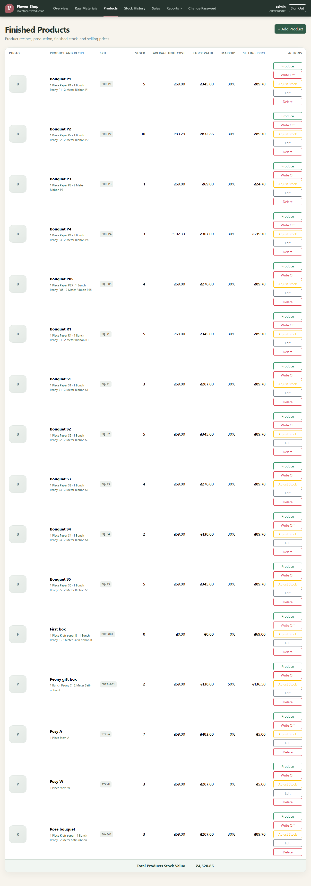

# a return refunds at the price charged, puts the units back, and ends with the sale returned in full

**Proves:** FR-111, FR-114, FR-115, FR-116, FR-118, FR-119, FR-120, FR-123, FR-126

**Result:** asserted

