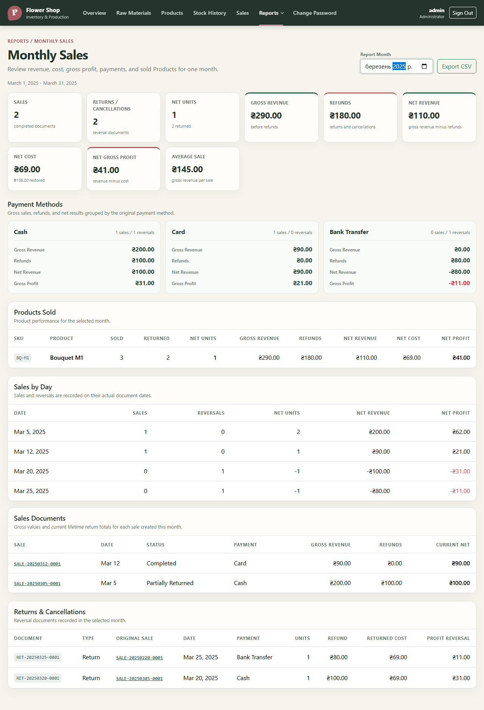

# the report counts a month by the dates of its documents and splits it by payment method, day and product

**Proves:** FR-136, FR-137, FR-138, FR-139, FR-140, FR-141, FR-142, FR-143

**Result:** asserted

